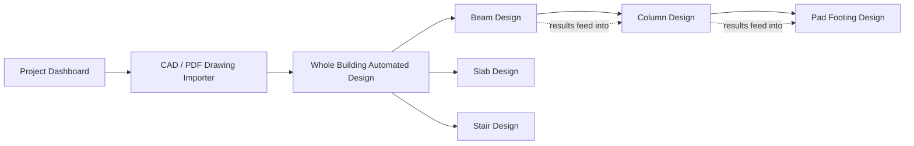

# Structural RCC Suite — User Manual

**A beginner-friendly guide to using the tool, menu by menu.**

This manual assumes you've never opened the app before. If you already
know structural engineering but not this specific tool, skip straight to
whichever module you need — each section stands alone.

> 📸 **Screenshot placeholders**: wherever you see a box like this —
> `[📸 SCREENSHOT: description of what to capture]` — that's a spot where
> a real screenshot of the running app should go. This manual was written
> without access to a live browser session, so those spots are marked but
> empty. Take the screenshot from your own deployment and drop it in.

---

## 1. What this tool is, in one paragraph

The Structural RCC Suite is a web app that helps you size reinforced
concrete elements (beams, columns, footings, slabs, stairs) to BS 8110 or
Eurocode 2, faster than doing it by hand or in a spreadsheet. You can type
in your own numbers, or upload a PDF/DXF drawing and let it pre-fill spans
and dimensions for you. Every result comes with a clear PASS/FAIL/WARNING/
NOT CHECKED audit trail — it never hides what it didn't check.

**It is a preliminary design aid, not a construction-ready output.** Every
calc sheet and drawing says this explicitly. Independent review by a
qualified engineer is still required before anything here goes to site.

---

## 2. Opening the app

You don't install anything. Open the link you were given in any web
browser (Chrome, Edge, Firefox all work fine). The app loads directly —
no sign-in is needed for this test version.

`[📸 SCREENSHOT: the app's very first loaded screen]`

---

## 3. The layout — sidebar and main area

Every screen in the app has the same basic shape:

- **Left sidebar**: a dropdown called "Design Module" — this is how you
  move between the different tools. Below it, a "Report details" section
  (optional project/engineer name) and a "Save/load project" section.
- **Main area**: whatever module you've selected — input forms at the
  top, results below once you calculate.

`[📸 SCREENSHOT: sidebar open, showing the Design Module dropdown expanded with all options visible]`

### The module map

You don't have to go in this order — every module also works completely
standalone with manually typed inputs. But the arrows above show how
results *can* flow from one to the next if you use the 🔗 linking
checkboxes (explained in Section 6).

---

## 4. Project Dashboard (your starting point)

This is what you see when you first open the app. It's a summary, not a
calculator — it collects whatever you've already calculated in other
modules and shows you the overall picture.

`[📸 SCREENSHOT: Project Dashboard with at least one element calculated, showing the pass/fail counts]`

- If you haven't calculated anything yet, it'll tell you so and point you
  to the sidebar.
- Once you've run a few modules, you'll see, for each element: how many
  checks passed, failed, or weren't checked.
- A **"Load path continuity"** section shows whether your Beam → Column →
  Footing reactions are actually connected (see Section 6).
- A **"Generate combined calc sheet"** button produces one downloadable
  report covering every element you've calculated — useful once you're
  done and want a single file to keep or send.

---

## 5. CAD / PDF Drawing Importer

Use this if you have an existing architectural drawing (PDF plan or DXF
file) and want the tool to read spans, footing sizes, and slab thickness
off it automatically, instead of typing them in by hand.

`[📸 SCREENSHOT: the importer's file upload button, empty state]`

### How to use it

1. Click "Upload Drawing File" and pick a `.pdf` or `.dxf` file.
2. The tool scans it and shows you what it found — labeled
   **✅ Detected** or **⚠️ Not detected**.

`[📸 SCREENSHOT: importer results showing a mix of detected (✅) and not-detected (⚠️) fields]`

### Important: it never guesses silently

If the tool can't confidently read a value off your drawing, it will
**never** quietly fill in a made-up number. It shows "Not detected" and
asks you to type the real value in yourself. This is deliberate — a
silently wrong number is far more dangerous than an honest gap.

3. Review every field in the confirmation form, correct anything wrong,
   and click **"Sync confirmed values to design modules."** Only after
   this step do the values become available to Beam/Slab/Footing Design.

`[📸 SCREENSHOT: the confirmation form with editable fields before syncing]`

---

## 6. Beam Design

This is usually where you'll start a real calculation.

`[📸 SCREENSHOT: Beam Design's input form, empty]`

### What to enter

| Field | What it means |
|---|---|
| Number of spans | How many beam spans in a row (1, 2, or 3+) |
| Span length | Length of each span, in metres |
| Beam width (b) / depth (h) | Cross-section dimensions, in mm |
| Other Dead Load Gk | Permanent load the beam carries, besides its own weight (kN/m) |
| Imposed Load Qk | Live/variable load (kN/m) |
| Wall height/thickness/unit weight | If a masonry wall sits on this beam |

Click **Calculate Beam**.

### Reading the results

`[📸 SCREENSHOT: Beam Design results — moments, shear, reinforcement, audit table]`

You'll see:
- **Span moment / support moment** — the bending the beam has to resist
- **Bottom steel / top steel** — the reinforcement selected, e.g. `3Y16`
  means 3 bars of 16mm diameter deformed bar
- **Shear links** — the stirrup spacing, e.g. `Y8 2-leg links @ 225mm c/c`
- **Deflection screening: PASS/FAIL** — a simplified serviceability check
- A **"Design verification" audit table** listing every individual check
  with its status

### Understanding the statuses

| Status | What it means |
|---|---|
| ✅ PASS | This specific check was performed and the member is adequate for it |
| ❌ FAIL | This specific check was performed and the member is NOT adequate |
| ⚠️ WARNING | Worth your attention, but not necessarily a failure |
| ⬜ NOT CHECKED | This version of the tool does not perform this check yet — it is **not** a claim of pass or fail, just an honest gap |

**NOT CHECKED is not the same as PASS.** If you see it, that check still
needs to be done independently before construction.

### If something FAILs

You'll see a 💡 tip suggesting what to change, and often a **"🔁 Retry
with..."** button that automatically reruns the calculation with the
suggested fix (e.g. depth +50mm). One click, no retyping.

`[📸 SCREENSHOT: a FAIL result showing the retry button]`

### Downloading your results

At the bottom of the results:
- **📄 Download calc sheet (HTML)** — a printable report with every input,
  result, and audit check, ready to attach to a submission
- **📐 Download reinforcement detail (DXF)** — an actual dimensioned
  drawing you can open in AutoCAD, BricsCAD, or LibreCAD

`[📸 SCREENSHOT: the two download buttons together]`

---

## 7. Column Design

`[📸 SCREENSHOT: Column Design's input form]`

### The 🔗 link to Beam Design

If you've already run Beam Design, you'll see a checkbox:
**"🔗 Pull beam reactions from the Beam Design result."** Leave it checked
and the column's loads are filled in automatically from your beam — no
retyping. Uncheck it if you want to enter loads by hand instead.

`[📸 SCREENSHOT: the 🔗 checkbox and how it locks the Gk/Qk fields]`

### Applied moments (new — read this if you know what a design moment is)

Most real columns carry some bending moment, not just pure axial load.
There are two optional fields, **Applied Mx** and **Applied My** (kNm) —
if you have design moments from your own frame analysis, wind, or beam
continuity, enter them here. If left at zero, the tool still checks the
code-mandated **minimum eccentricity** moment (a small moment every column
must resist by code, even under "pure" axial load) — it never treats a
column as truly moment-free, because the code doesn't allow that either.

### Reading the moment interaction result

`[📸 SCREENSHOT: the "Biaxial moment-axial interaction" section of the results]`

This uses a **simplified, deliberately conservative** approximation — not
a full column interaction chart. Treat a close-to-1.0 utilization or a
FAIL the same way: "check this with a full design chart before
construction," not "this column doesn't work." The limitations section on
the calc sheet explains exactly why it's conservative.

---

## 8. Pad Footing Design

`[📸 SCREENSHOT: Pad Footing Design's input form]`

Works the same way as Column Design — a 🔗 checkbox pulls the axial load
straight from your last Column Design result, plus the column's plan
dimensions.

Key result to watch: **Service Bearing Pressure vs. Soil Bearing
Capacity** — shown as a utilization bar so you can see at a glance how
much margin you have, not just pass/fail.

`[📸 SCREENSHOT: the bearing pressure utilization bar]`

---

## 9. Slab Design

`[📸 SCREENSHOT: Slab Design mode selector — One-way vs Two-way]`

Choose **One-way** (a simply supported strip, e.g. a slab spanning
between two beams) or **Two-way** (a rectangular panel supported on all
four sides — pick the panel/edge condition that matches your layout, e.g.
"Interior Panel," "One Short Edge Discontinuous," etc.).

`[📸 SCREENSHOT: Two-way slab panel type dropdown]`

---

## 10. Stair Design

`[📸 SCREENSHOT: Stair Design input form]`

Straightforward span/rise/going inputs for a straight flight. Results
follow the same PASS/FAIL/audit pattern as everything else.

---

## 11. Whole Building Automated Design

`[📸 SCREENSHOT: Whole Building module inputs]`

This runs a full slab → beam → column → footing sequence for one
representative bay of a building, rather than one element at a time. Good
for a fast first pass across a whole floor. It also produces a bar
bending schedule (BBS) and a rough steel cost estimate.

**Important limitation**: it analyzes *one representative internal bay*
and applies that result project-wide — it does not yet model your actual
full grid with real edge/corner bays and unequal spans. Treat it as a fast
first estimate, not a substitute for designing each real bay.

---

## 12. Project-wide tools

### Save / load your project

In the sidebar under "💾 Save / load project":
- **Save project (.json)** downloads everything you've calculated so far
  as one file.
- **Load project (.json)** lets you re-upload that file later (even on a
  different day, different computer) to pick up exactly where you left
  off.

`[📸 SCREENSHOT: the sidebar save/load section]`

### Settings-drift warning

If you calculate a beam using, say, fcu=25, then later change the
concrete grade in the sidebar, the beam's results page will show a
warning that it no longer matches your current settings. This stops old
results from silently going stale — recalculate when you see this.

`[📸 SCREENSHOT: a settings-drift warning banner]`

---

## 13. Glossary — quick reference for less familiar terms

| Term | Meaning |
|---|---|
| Gk | Characteristic **permanent** (dead) load |
| Qk | Characteristic **variable** (live/imposed) load |
| fcu | Concrete cube compressive strength (BS8110 convention), MPa |
| fck | Concrete cylinder compressive strength (Eurocode convention), MPa |
| fy | Steel yield strength, MPa |
| As,req / As,prov | Reinforcement area required / actually provided |
| c/c | Centre-to-centre (bar spacing) |
| span/d | Span-to-effective-depth ratio, used as a quick deflection screen |
| NOT CHECKED | A check this tool doesn't yet perform — always needs independent verification |

---

## 14. If something goes wrong

- **App won't load / asks you to sign in**: this is a Streamlit Cloud
  access-permission issue on the deployment side, not something you did —
  tell whoever gave you the link.
- **A number looks wrong, not just incomplete**: this is the most useful
  bug report you can give — note exactly what inputs you used and what
  you expected instead.
- **DXF won't open in your CAD software**: try a different DXF-capable
  viewer (LibreCAD is free) to confirm whether it's the file or your
  software, and report which one you tried.

---

*This manual covers the app as of the current build. Some sections
(module names, exact field labels) may drift slightly as the tool
evolves — if something in the app doesn't match what's described here,
trust the app and flag the mismatch as feedback.*
